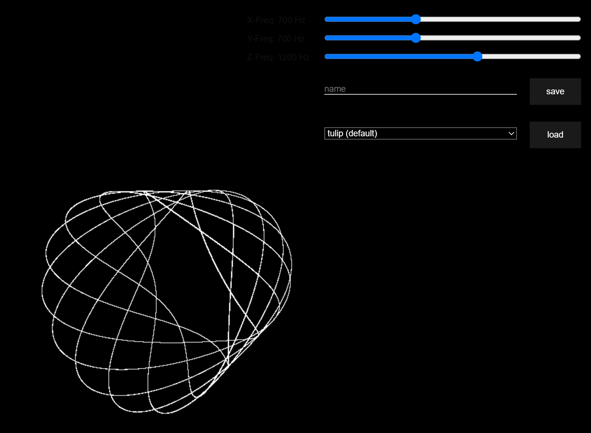
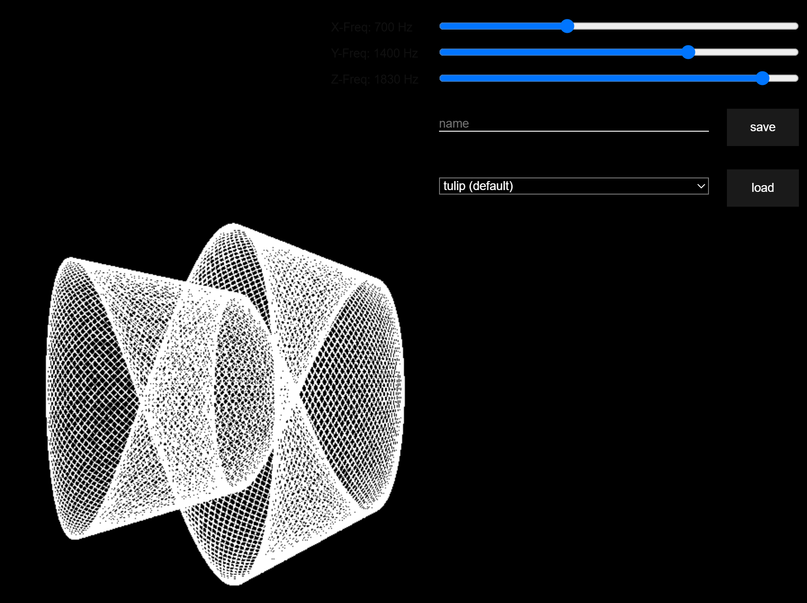

Lissajous — 3D Oscilloscope Figures
=================================

This small project generates and displays 3D Lissajous figures (the beautiful patterns you may have seen on an oscilloscope). It was inspired by physics class demos and experiments with three.js to render Lissajous curves in three dimensions.

Features
- Interactive controls for X/Y/Z frequencies and other parameters
- Save/load presets

Screenshots





Quick start
-----------

To start a lightweight static file server and open the project in your browser run:

```
npx serve .
```

This will serve the repository root at http://localhost:3000.

Controls and tips
- Use the sliders to change the X, Y and Z frequencies.
- Try integer frequency ratios (e.g. 1:2:3) to get closed, symmetric figures.

Development
- The project uses plain JavaScript and three.js for rendering — inspect the source files in the repository to modify behaviour or add presets.

